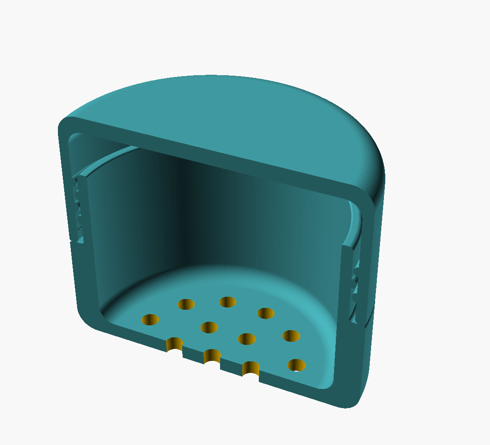

# Hộp bàn chải điện

Hộp đựng bàn chải điện có nắp vặn, dựng bằng OpenSCAD tham số. Source độc lập, không import STL hoặc cần thư viện SCAD bên ngoài.

Có thêm [script Autodesk Fusion](fusion/README.md) với **cổ thân ren tròn ngoài, nắp ren trong** như vị trí trong SCAD. Phiên bản6 dùng gờ ren Join nhô vào lòng nắp Ø48 xuyên tới miệng, 2,5 vòng/pha90° như SCAD; giữ lòng thân/cổ Ø42,4. Ren dùng surface helix và Sweep tròn, không Loft hoặc miệng thắt; Bản6.2 nghiêng bốn mặt đầu ren 70° theo F3D chỉnh tay; hai đầu vẫn chưa fade như SCAD. Các bước này chỉ có trong script Fusion, STL OpenSCAD không đổi. Cần Fusion September 2026 trở lên. Đã kiểm thử tính toán; chưa chạy kiểm chứng bản mới trong Fusion hoặc in thử; không dùng lẫn với cặp SCAD cũ.



Source chính ở ngoài cùng:
- `hop-ban-chai-dien.scad`: bản đầy đủ.
- `in-thu.scad`: bản in thử ngắn, cùng đường kính, ren và đáy.

Trong mỗi file và bảng Customizer, thông số được chia thành hai nhóm:
- `Common settings - mm`: phần xuất, đường kính ngoài, chiều cao thân/nắp, độ dày thành/đáy, bo đáy ngoài/trong, bật/tắt và đường kính lỗ thoát nước, độ hở ren.
- `Advanced settings`: vị trí cổ, các bo mép nhỏ, hình học và vị trí ren, bố trí vòng lỗ, độ mịn mesh. Các giá trị tính toán nằm trong `Hidden`.

Đường kính lòng thân = đường kính ngoài trừ hai lần độ dày thành. Khi đổi chiều cao thân/nắp, cần chỉnh tương ứng `shoulder_height`, `body_thread_z`, `cap_thread_z` trong nhóm nâng cao; các vị trí này vẫn là giá trị tuyệt đối, chưa tự thay đổi theo chiều cao.

Kích thước hiện tại, đơn vị mm:
- Lòng thân và miệng ren cùng Ø42,4; thành trong thẳng, không còn đoạn thắt ở cổ.
- Đường kính ngoài thân/nắp Ø51,4; thành thân 4,5; thành cổ ren 1,8; thành nắp 1,7.
- Bo đáy ngoài thân/nắp R3,6; bo đáy trong R2,8; đáy dày 2,6.
- Bản đầy đủ: thân cao 213,6; nắp cao 85,2; khi đóng cao 285,2; chiều dài lòng hữu dụng 280.
- Bản thử: thân cao 31,6; nắp cao 24; khi đóng cao 42.
- Đáy thân có 19 lỗ Ø3: một lỗ tâm, vòng 6 lỗ bán kính 7, vòng 12 lỗ bán kính 14. Không có lỗ bên hông.
- Ren và nắp đã tăng đường kính theo cổ mới; dùng cả thân và nắp của bản mới.

Đầu ra:
- `exports/ban-day-du/`: STL, ảnh và audit bản đầy đủ.
- `exports/in-thu/`: STL, ảnh và audit bản in thử.
- `body.stl`: thân; `cap.stl`: nắp; `layout.stl`: cả bộ. In 100%, đơn vị mm.

### Chỉnh sửa và xuất STL

Mở một trong hai file `.scad` ở thư mục gốc bằng OpenSCAD. Trong Customizer, `output_part` chọn body/cap/layout/assembled/section/bottom_detail. Dùng Render (F6), rồi Export as STL. Có thể dùng ngay các STL đã xuất trong `exports/`.

Để build bằng lệnh, cần Python và OpenSCAD có backend Manifold. Bộ xuất hiện tại được kiểm tra bằng OpenSCAD nightly 2026.09.29. Đưa executable OpenSCAD vào PATH, hoặc truyền `--openscad "duong-dan-den-openscad.com"` trên Windows (`openscad` trên Linux/macOS). Cũng có thể đặt biến môi trường `OPENSCAD_EXECUTABLE`.

Chạy từ thư mục gốc project:

```powershell
python Nguon/electric-toothbrush-case-bottom19/build.py --previews --check-variants
python Nguon/electric-toothbrush-case-print-test/build.py --previews
```

Build chỉ dùng thư viện chuẩn Python. Các script audit cần dependency trong `requirements.txt`:

```powershell
python -m venv .venv
.venv/Scripts/python -m pip install -r requirements.txt
.venv/Scripts/python Nguon/electric-toothbrush-case-bottom19/audit_model.py
.venv/Scripts/python Nguon/electric-toothbrush-case-print-test/audit_trial.py
.venv/Scripts/python Nguon/electric-toothbrush-case-bottom19/verify_straight_bore.py
```

Trên Linux/macOS, thay `.venv/Scripts/python` bằng `.venv/bin/python`. Các phiên bản dependency được ghi theo môi trường Python 3.12.14 đã chạy audit; khả năng cài trên các phiên bản Python/OS khác chưa được kiểm chứng. Chạy audit với Python thông thường, không dùng `-O` hoặc đặt `PYTHONOPTIMIZE`, vì các kiểm tra sử dụng `assert`.

Audit bản đầy đủ cần các file kiểm tra được tạo bằng `--check-variants`; bản thử cần STL bản đầy đủ để đối chiếu. Kết quả ghi vào `exports/*/audit.json`. Các audit xác nhận kích thước mặc định, không tự suy ra kỳ vọng khi đổi thông số thiết kế.

### Kiểm chứng

Các STL mặc định đã được kiểm tra mesh kín, hướng mặt nhất quán, 19 lỗ đáy Ø3, lòng thân Ø42,4 xuyên cổ và ren không va chạm tại 10 vị trí lấy mẫu. Bản in thử giữ cùng đáy và ren với bản đầy đủ. Đây là kiểm tra hình học số; chưa kiểm chứng bằng bản in thực tế hoặc đo bàn chải cụ thể.

## Bộ tài liệu agent tự học.

[Cẩm nang dùng chung](https://github.com/TimTini/snaplock-storage-box/blob/main/docs/agent-learning.md) tổng hợp quy trình SCAD trước rồi Fusion Python sau. [Sổ lỗi và cách sửa](https://github.com/TimTini/snaplock-storage-box/blob/main/docs/error-cookbook.md) ghi các ca kỹ thuật cùng phạm vi kiểm chứng. [Mẫu giao việc](https://github.com/TimTini/snaplock-storage-box/blob/main/docs/scad-to-fusion-task.md) áp dụng quy trình cho model mới.
