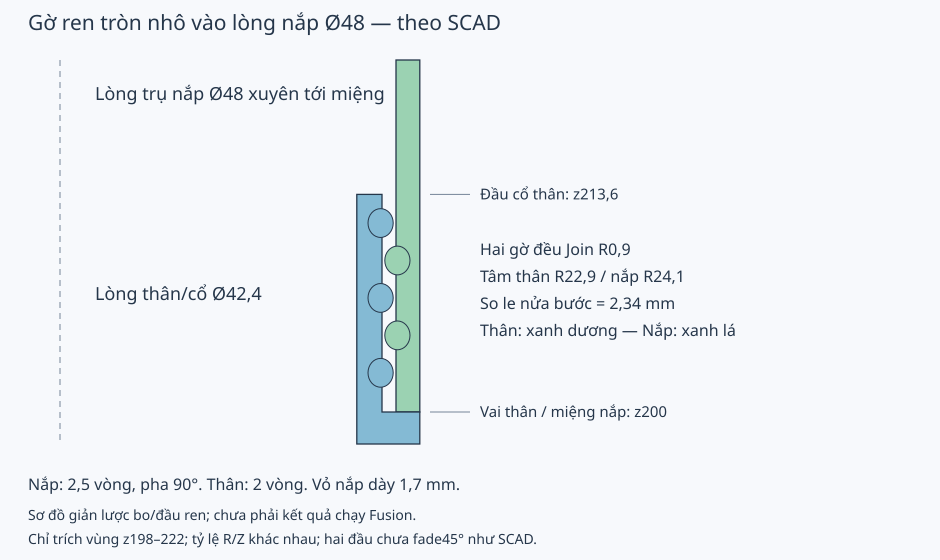

# Hộp bàn chải điện — Fusion, gờ ren trong nắp theo SCAD

Phiên bản **6.2.0** tạo một component **ElectricToothbrushCase** chứa hai solid bodies: **Body** dài có cổ và ren ngoài; **Cap** ngắn chụp ngoài, có gờ ren tròn nhô vào lòng. Cả hai ren dùng **Sweep Join**. Nắp có lòng trụ Ø48 xuyên tới miệng, không có đoạn thắt Ø46,4, không Cut rãnh và không có côn/Loft như phiên bản5.

## Chạy script

1. Dùng Fusion **September 2026 trở lên**, vào **Utilities > Add-Ins > Scripts and Add-Ins > Scripts > +**, chọn thư mục `ElectricToothbrushCase` có Python/manifest, rồi **Run**.
2. Mỗi Run tạo document Parametric mới. Để áp dụng bốn bước nghiêng mặt đầu ren của bản6.2, Run lại; document cũ không tự chuyển cấu trúc.
3. Chỉnh **Modify > Change Parameters**. Sketch, Extrude, Fillet, Sweep, Pattern và Move có expression liên kết. Không sửa nhóm phụ thuộc có comment “Tự tính; giữ công thức”.
4. `SHORT_TEST = True`: tạo thân/nắp **31,6 / 24 mm** với cùng đường kính, đáy và ren. Mặc định False tạo **213,6 / 85,2 mm**.
5. `VERIFY_VARIANTS = True`: kiểm tra đổi cao, Ø60, bản ngắn, số vòng, pha ren nắp, bước/tiết diện/khe hở và cỡ lỗ, rồi phục hồi Parameters. Khi lỗi, hộp thoại/log nêu bước; giữ document lỗi để xem timeline.
6. Xuất solid **Body** hoặc **Cap** bằng Save as Mesh, đơn vị mm, scale100%. Hai surface **helix helper** đã ẩn chỉ dựng đường ren, không xuất.

Trong Browser, mở **ElectricToothbrushCase > Bodies** để chọn riêng **Body** hoặc **Cap**. Hai surface **helix helper** ẩn cũng nằm trong component này, không phải solid để in. Timeline dựng nắp rồi Move sang bên trước khi dựng thân, tránh Join gộp hai phôi chồng nhau.

Script hiển thị hai phần đứng cạnh nhau, đáy xuống bàn in; chưa tạo joint hoặc tư thế assembled. Không có add-in chạy nền chặn giá trị sai sau Change Parameters. Kiểm tra timeline và giới hạn trước xuất. `check_model(design)` có thể gọi trong môi trường API/debug Fusion để kiểm tra lại document hiện tại.

## Đối chiếu với SCAD

SCAD `cap()` dùng `union()` thêm `round_thread()` vào mặt trong nắp. Bản5 trước đó chỉ khôi phục vị trí ren trên thân/nắp, vẫn Cut rãnh trong miệng thắt; đó là khác biệt đã được sửa trong bản6.

| Thông số mặc định, mm trừ khi ghi khác | SCAD | Fusion6 |
|---|---:|---:|
| Ø ngoài | 51,4 | 51,4 |
| Cao thân/nắp | 213,6 / 85,2 | 213,6 / 85,2 |
| Cao bản ngắn | 31,6 / 24 | 31,6 / 24 |
| Lòng thân/cổ | Ø42,4 | Ø42,4 |
| Lòng nắp xuyên tới miệng | Ø48 | Ø48 |
| Cổ ngoài / vai thân | Ø46 / z200 | Ø46 / z200 |
| Tâm ren thân / nắp | R22,9 / R24,1 | R22,9 / R24,1 |
| Bán kính tiết diện hai gờ | 0,9 | 0,9 |
| Bước ren | 4,68 | 4,68 |
| Số vòng thân / nắp | 2 / 2,5 | 2 / 2,5 |
| Pha đầu ren thân / nắp | 0° / 90° | 0° / 90° |
| Z đầu ren thân / nắp | 202,45 / 71,2 | 202,45 / 71,2 |
| Z đầu ren bản ngắn | 20,45 / 10 | 20,45 / 10 |
| Thành cổ / thành nắp | 1,8 / 1,7 | 1,8 / 1,7 |
| Đáy / bo ngoài / bo trong | 2,6 / R3,6 / R2,8 | 2,6 / R3,6 / R2,8 |
| Lỗ đáy thân | 19 × Ø3; R7/R14; 1+6+12 | Như SCAD |
| Cao đóng đầy đủ / ngắn | 285,2 / 42 | 285,2 / 42 |



Mặt cắt giản lược, không phải ảnh BRep Fusion. Lật nắp X180°, xoay Z=`assembly_rotation`, tịnh tiến Z=`assembly_height`; đưa nắp từ x=`outside_diameter + layout_gap` về trục trước khi lắp. Miệng nắp tì vai thân z200. Hai gờ ren **xen giữa nhau nửa bước**, không có hai đường tâm trùng nhau như bản Cut cũ. Góc xoay mặc định 798,461538° tương đương78,461538°.

Phần khác còn lại so với mesh SCAD: Sweep native dùng tiết diện tròn đều vuông góc đường tâm, hai đầu có mặt kết thúc; SCAD dùng tiết diện trong mặt phẳng radial/Z và thu nhỏ dần ở45° đầu/cuối. Bản6 phục hồi gờ ren, lòng nắp, số vòng, pha và vị trí danh nghĩa; **chưa sao chép fade45°**, không tuyên bố mesh giống tuyệt đối hoặc dùng lẫn với bộ SCAD đã in. Các bo nhỏ vẫn theo Parameters Fusion hiện có.

## Bốn mặt đầu ren theo bản F3D chỉnh tay

F3D/STEP chỉnh tay là dữ liệu CAD tham chiếu riêng, chỉ dùng trong phát triển và kiểm chứng cục bộ; chúng không được phân phối cùng repo. Bản6.2 tái tạo bốn MoveFace cuối timeline ngay sau Sweep Join của từng phần: **Cap start/end thread tilt** trước Cap print layout, **Body start/end thread tilt** trước các lỗ đáy. Vẫn một component/hai solid.

Góc chung `thread_end_tilt = 70 deg`. Trục xoay nằm trong plane vuông góc helix, theo hướng binormal; vị trí trục lệch theo bán kính so với tâm tiết diện. Chiều nghiêng hai đầu đối nhau, thân/nắp đối nhau. Các giá trị mặc định được khôi phục từ transform F3D và đối chiếu phương trình mặt phẳng STEP bằng dữ liệu tham chiếu riêng trong kiểm chứng cục bộ, không phải chọn lại tâm xoay bằng mắt.

| Tham số tỷ lệ trục / bán kính ren | Mặc định gần đúng | Độ lệch trục khi R ren=0,9 mm |
|---|---:|---:|
| `cap_start_pivot_fraction` | 0,555547 | 0,499992 mm vào lòng |
| `cap_end_pivot_fraction` | 0,514554 | 0,463099 mm vào lòng |
| `body_start_pivot_fraction` | 0,555545 | 0,499991 mm ra ngoài |
| `body_end_pivot_fraction` | 0,371334 | 0,334201 mm ra ngoài |

`offset = thread_radius * *_pivot_fraction`. Sketch trục project liên kết endpoint helix và trục Z; dùng perpendicular/parallel và chiều dài driving. Move Feature dùng Rotate với expression góc; không dùng FreeMove/matrix cố định. Mỗi đầu cần một sketch trục, tái sử dụng plane profile đầu có sẵn và thêm một plane cho đầu kia của mỗi phần. Năm tham số mới có comment tiếng Việt. Giữ tỷ lệ trong (0;1), góc trong (0;80°); đây là giới hạn đầu vào, không bảo đảm mọi biến thể kernel đều dựng được.

Script tìm mặt đích theo phương trình plane tại đầu helix, không theo face index. Khi không có đúng một mặt đích, thiếu projection hoặc kernel báo lỗi thì dừng và giữ document để kiểm tra. Checker so lại góc và plane sau recompute/cap layout; `VERIFY_VARIANTS=True` có thêm góc60° và đổi tỷ lệ trục. Kiểm chứng offline chỉ xác nhận phương trình bốn plane mặc định và các frame biến thể; chưa chứng minh toàn bộ BRep giống các STEP tham chiếu riêng hoặc ren sau Move Face không giao nhau. Cần Run trong Fusion rồi kiểm tra interference/bản in thử trước xuất dùng.

Tài liệu API: [MoveFeatures.createInput2](https://help.autodesk.com/cloudhelp/ENU/Fusion-360-API/files/fusion_MoveFeatures_createInput2.htm), [defineAsRotate](https://help.autodesk.com/cloudhelp/ENU/Fusion-360-API/files/fusion_MoveFeatureInput_defineAsRotate.htm), [project2](https://help.autodesk.com/cloudhelp/ENU/Fusion-360-API/files/fusion_Sketch_project2.htm), [addPerpendicular2](https://help.autodesk.com/cloudhelp/ENU/Fusion-360-API/files/fusion_GeometricConstraints_addPerpendicular2.htm).

## Parameters chính

Parameters thêm theo thứ tự hình dáng → cổ/bo → ren → lỗ/layout → công thức phụ thuộc. Lọc tên `thread_`, `cap_`, `drain_`, `neck_`. Tất cả đầu vào có comment tiếng Việt có dấu.

| Parameter | Mặc định | Tác dụng |
|---|---:|---|
| `outside_diameter` | 51,4 mm | Ø ngoài chung |
| `body_height`, `cap_height` | 213,6 / 85,2 mm | Cao thân gồm cổ; cao nắp toàn phần |
| `wall_thickness`, `bottom_thickness` | 4,5 / 2,6 mm | Thành thân, đáy hai phần |
| `outside_bottom_radius`, `inside_bottom_radius` | 3,6 / 2,8 mm | Bo đáy |
| `neck_height`, `neck_wall` | 13,6 / 1,8 mm | Chiều dài/thành cổ thân |
| `neck_lip_radius`, `mouth_inside_radius`, `shoulder_radius` | 0,8 / 0,7 / 0,35 mm | Bo đầu cổ, dẫn vào, vai/miệng |
| `thread_pitch`, `thread_radius`, `thread_embed` | 4,68 / 0,9 / 0,1 mm | Bước, bán kính tròn, tâm chìm vào thành |
| `thread_turns` | 2 | Số vòng ren thân |
| `cap_extra_turns` | 0,5 | Nắp thêm nửa vòng, cùng bước với thân |
| `cap_thread_phase` | 90° | Pha đầu ren nắp; giới hạn0°<pha<180° cho sketch góc |
| `thread_offset`, `cap_thread_offset` | 2,45 / 0,4 mm | Vị trí đầu ren tính từ vai thân / độ lùi so chiều dài cổ ở nắp |
| `thread_clearance` | 0,2 mm | Khoảng hở bán kính giữa đỉnh ren thân và lòng trụ nắp |
| `bottom_drain_diameter`, `drain_target_web` | 3 / 4 mm | Ø lỗ, vật liệu mục tiêu theo cung |
| `drain_inner_fraction`, `drain_outer_fraction` | 7/21,2; 14/21,2 | R vòng lỗ theo R lòng thân |
| `drain_outer_phase`, `layout_gap` | 15° / 12 mm | Pha vòng ngoài, khoảng xếp in |

`cap_wall` nay là kết quả tính từ cặp ren, mặc định1,7 mm. Không còn `cap_groove_*`, `cap_mouth_*`, `cap_transition_*` hoặc côn lòng. Thay đổi cỡ ren/khe hở sẽ đổi lòng nắp tương ứng; không giữ hai contract cũ/mới.

## Công thức

```text
outer_r = outside_diameter / 2
body_inner_r = outer_r - wall_thickness
neck_inner_r = body_inner_r
neck_r = neck_inner_r + neck_wall
body_shoulder_height = body_height - neck_height
body_thread_centre_r = neck_r - thread_embed
cap_inner_r = body_thread_centre_r + thread_radius + thread_clearance
cap_wall = outer_r - cap_inner_r
cap_thread_centre_r = cap_inner_r + thread_embed
cap_thread_turns = thread_turns + cap_extra_turns
body_thread_height = thread_pitch * thread_turns
cap_thread_height = thread_pitch * cap_thread_turns
body_thread_z = body_shoulder_height + thread_offset
cap_thread_z = cap_height - neck_height - cap_thread_offset
assembly_height = body_shoulder_height + cap_height
assembly_rotation = (assembly_height - cap_thread_z + thread_pitch * cap_thread_phase / (360 deg) - body_thread_z - thread_pitch / 2) / thread_pitch * 360 deg
usable_length = assembly_height - 2 * bottom_thickness
```

Công thức xoay giống SCAD nhưng không lấy modulo360; góc tương đương. Tại cùng góc quanh trục, đường tâm gờ nắp sau lật nằm lệch đường tâm gờ thân nửa bước2,34 mm. Tâm hai ren lệch bán kính1,2 mm. Không lấy khe hở0,2 để nới tiết diện ren nắp: hai gờ đều R0,9. Khe hở0,2 giữa đỉnh ren thânR23,8 và lòng trụ nắpR24.

Giữ thành cổ≥1,8, thành nắp≥1,2, bước>4×R ren, số vòng thân≥1. Ren phải ở trên bo đáy, dưới bo miệng/đầu cổ; tăng số vòng cần kiểm tra chiều cao và chiều dài cổ. Python kiểm tra điều kiện khi Run, không chặn trực tiếp mọi sửa Parameters. Ren thân dài9,36 mm; nắp11,7 mm. Chiều dài giữa đáy trong280 mm, bản ngắn36,8 mm; tổng dung tích/vật chứa thực chưa đo.

## Thoát nước

R vòng = `body_inner_r * drain_*_fraction`; số lỗ mỗi vòng = `max(3; floor(2 * PI * drain_*_r / (bottom_drain_diameter + drain_target_web)))`. Thêm một lỗ tâm. Python kiểm tra khoảng vật liệu Euclid giữa mọi cặp≥3 mm và mép lỗ tới bo lòng≥2,5 mm. Cấu hình không vừa báo lỗi, không âm thầm đổi cỡ lỗ. Ø60 có23 lỗ; lỗØ3,5 ở vỏ mặc định có17 lỗ.

## Timeline và kiểm chứng

Thân: blank tới vai → neck Join → cavity → fillets → helix surface → round thread Join → start/end thread tilt → centre drain → hai seed Cut + Circular Pattern. Nắp: blank → cavityØ48 → fillets → helix surface có pha → round thread Join → start/end thread tilt → Move xếp in. Mỗi phần **hai Sweep, không Loft**; helix helper được ẩn.

Surface Sweep xoắn tạo helix liên kết expression; Sweep tròn Join tạo gờ native. Pha nắp dùng angular dimension trong sketch, bán kính dùng aligned dimension; tâm tiết diện project liên kết lên plane vuông góc đầu helix. Tài liệu Autodesk: [twistAngle](https://help.autodesk.com/cloudhelp/ENU/Fusion-360-API/files/fusion_SweepFeatureInput_twistAngle.htm), [setByPath](https://help.autodesk.com/cloudhelp/ENU/Fusion-360-API/files/fusion_ConstructionPlaneInput_setByPath.htm), [project2](https://help.autodesk.com/cloudhelp/ENU/Fusion-360-API/files/fusion_Sketch_project2.htm), [angular dimension](https://help.autodesk.com/cloudhelp/ENU/Fusion-360-API/files/fusion_SketchDimensions_addAngularDimension.htm), [aligned dimension](https://help.autodesk.com/cloudhelp/ENU/Fusion-360-API/files/fusion_DimensionOrientations.htm).

```powershell
python3.12 -m unittest discover -s tests -v
python3.12 -m py_compile fusion/ElectricToothbrushCase/ElectricToothbrushCase.py
```

- **Source/API:** đã đối chiếu SCAD và tài liệu; không suy ra kernel dựng thành công từ source.
- **Tính toán:** 13 test đạt. Hai test mới so bốn plane với STEP và kiểm tra trục theo bản ngắn, đường kính, pha, bước, tiết diện và góc; RED trước khi thêm hàm frame. Có RED/GREEN cho Cap Cut→Join, đối chiếu scalar trực tiếp hai file SCAD, công thức/lắp so le nửa bước và lấy mẫu3D khoảng cách hai gờ trên toàn ren thân. Ca lấy mẫu khoảng cách kiểm tra đường tâm gờ tròn trước khi nghiêng mặt đầu. Đây là lấy mẫu, không chứng minh khoảng cách nhỏ nhất liên tục hoặc tương thích mesh cũ.
- **Fusion runtime:** người dùng chạy bản6 và gặp `Unconstrained sketch: Cap helix radius` ở kiểm tra cuối. Bản6.0.1 thay đường chuẩn góc `isFixed` bằng đoạn construction gắn gốc, horizontal và chiều dài driving 5 mm; giữ angle/radius theo Parameters và kiểm tra constraints ngay trước dựng helix. Các F3D/STEP tham chiếu riêng có các feature bản6.1 và bốn MoveFace; đó là bằng chứng document đã được tạo/chỉnh, chưa xác nhận checker/variants từng đạt. Bản6.2 bổ sung Move Rotate parametric; chưa được chạy trong Fusion. `check_model` kiểm tra health/constraints, một component chứa đúng hai solid tên Body/Cap, bốn Sweep, bốn Move Rotate mặt và một Move bố trí nắp, plane đầu ren, kích thước/lòng/pattern và49 điểm mỗi helix theo bán kính/chiều cao/pha riêng. Cần Run với `VERIFY_VARIANTS=True`, đặc biệt kiểm tra angular sketch pha90°, recompute và Join gờ vào thành.
- **In thực tế:** chưa in. In cặp ngắn cùng vật liệu/profile, kiểm tra đầu ren, đủ hành trình tới vai, độ rơ/kẹt và overhang. Đầu ren chưa fade như SCAD; cần kiểm tra interference ở tư thế đóng và giữa hành trình trong Fusion trước xuất/in.

SCAD/STL gốc giữ nguyên. Nhật ký phát triển và dữ liệu CAD tham chiếu riêng được lưu cục bộ, không phân phối cùng repo.
